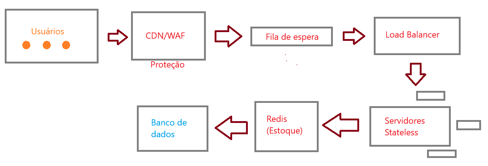

# Arquitetura proposta

## Esquema básico

[ Usuários ] -> [Fila de Espera] -> [Servidores (Sem Memória)] ->
[ Memória Rápida (Redis) ] -> [ Banco de dados ]

### Principais componentes

#### Fila de Espera (Ordem de Chegada):

* Todo usuário que chega entra numa fila digital por ordem de chegada (FIFO).
* Sistema libera o acesso em lotes controlados, para que ficque sobrecarregado.
* Quem entrar no sistema terá um tempo de sessão fixo (por exemplo: 10 minutos) para efetuar a compra, o que protege quem tem a internet mais lenta.

#### Servidores (Arquitetura Stateless/ Sem Estado):

* Utilizam-se vários servidores iguais atrás de um distribuidor de tráfego.
* Eles não guardam dados do usuário na memória interna. Se um servidor cair ou travar, o usuário é jogado para outro sem perder a vez ou o carrinho (ingressos no carrinho de compras).

#### Controle de ingressos (Redis / Memória Atômica)

* Para evitar mais ingressos do que o limite de vendas: o estoque fica guardado em uma memória de alta velocidade (Redis).
* Ele usa operações que acontecem em um único ciclo de processamento (atômicas). Se o último ingresso for comprado por duas pessoas no mesmo milissegundo, apenas a primeira requisição será exitosa, enquanto a segunda é bloqueada.

#### Banco de dados (Final):

* Utilizando um banco relacional tradicional, aciona-se este para salvar o pagamento aprovado e emitir o ingresso oficial. 

#### Esquema

